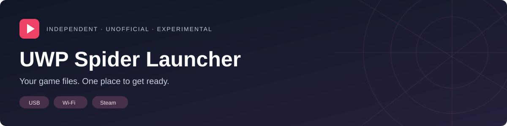

# UWP Spider Launcher

**Bring your own game. Import, prepare, and launch from one place.**

An unofficial UWP launcher for Xbox Developer Mode, with USB folder import, local Wi-Fi transfer, and Steam downloads through SteamKit.

> **Experimental • 0.6.0.1**
>
> Source preview. No public installer is available yet. Playing requires a compatible, separately installed game runtime, which is **not included** in this repository.

[Getting started](docs/GETTING-STARTED.md) · [Build from source](release/REBUILD-FROM-SOURCE.md) · [Project status](release/STATUS.md) · [Licenses & notices](THIRD-PARTY-NOTICES.txt)

## Three ways to bring your files

| USB drive | Local Wi-Fi | Steam |
| --- | --- | --- |
| Import a supported game folder directly from a connected drive. | Send a folder from a PC browser using the address or QR code and pairing code shown on Xbox. | Approve sign-in in the Steam mobile app and download the supported version you own. |
| Folder and ZIP imports. | No ZIP required; ZIP transfer is also available. | Progress, file verification, and resumable downloads. |

## What it does

- **Prepare on Xbox:** generate the required asset variants from your own supported game files.
- **Verify your import:** check supported versions and file hashes before marking files ready.
- **Keep your languages:** USB and Wi-Fi imports copy all included supported voice packs. Steam download currently selects English.
- **Manage storage:** view available space and remove prepared game files through a confirmation screen.
- **Launch your game:** open the separately installed runtime once preparation is complete.

## Before you start

- An Xbox in Developer Mode. Current console testing is on **Series X**; Series S support is not verified.
- Your own copy of **Marvel’s Spider-Man Remastered**, matching supported Steam build **14752622**. A newer installation is not automatically compatible.
- A matching game runtime and its preparation support, installed separately.
- Enough free storage for the import and generated files. The launcher checks space before proceeding.

**This repository is the launcher and preparation tooling—not a complete game or standalone game port.** It includes no game assets, saves, game executable, or compatibility-runtime binaries/source.

## The workflow

**Import or download → Verify → Prepare game → Play**

For Wi-Fi, open the receiver in the launcher, scan its QR code or enter its address on your PC, pair, and select the game folder. For Steam, scan the sign-in QR code with the Steam mobile app. Never post sign-in QR codes or tokens in an issue.

See the [setup guide](docs/GETTING-STARTED.md) for requirements and limitations.

## Development

The app uses C#/XAML and the UWP .NET Native toolchain. Preparation uses shared C# code and a native texture-conversion helper.

| Folder | Contents |
| --- | --- |
| `source/` | Launcher UI, imports, Steam transfer, and preparation orchestration |
| `asset-preparation/` | Converter source and numeric recipes |
| `build/` | Launcher build and icon-generation scripts |
| `licenses/` | Third-party license texts |
| `docs/` | User documentation and original project artwork |
| `release/` | Build instructions, dependency pins, and release requirements |

[Build instructions](release/REBUILD-FROM-SOURCE.md) · [Source scope](SOURCE-SCOPE.md)

## Status and limitations

USB import and on-console preparation have been exercised in earlier builds. The direct SteamKit candidate has passed local transfer checks, and the owner reports that Steam works on Xbox. A complete fresh download, interruption/resume, preparation, and play-through verification for this candidate is still pending.

Binary distribution remains pending the checks in [project status](release/STATUS.md). Tests passing does not mean every dependency or the separate runtime is cleared for redistribution.

## License and attribution

Component licenses and upstream notices are listed in [THIRD-PARTY-NOTICES.txt](THIRD-PARTY-NOTICES.txt). See [license status](LICENSE-REVIEW.md) for the remaining distribution work.

UWP Spider Launcher is an independent, unofficial project. It is not affiliated with or endorsed by Microsoft, Valve, Sony, Marvel, or the game's developers or publishers. Product names are used to identify compatibility.
